# Narsil

<p align="center">
  
  
</p>

> **Narsil Workshop · [narsil.davshn.tech](https://narsil.davshn.tech)**
>
> A free workshop, in English, Spanish, Italian, French, and Brazilian Portuguese, that teaches step by step how to build Claude Code mods like Narsil and [Narsil Check](https://github.com/davshn/narsil-check), and how to build a Narsil desk bot with a body: an ESP32-P4 touch screen in the belly and a holographic ESP32-S3 head, which talks through Xiaozhi and Claude on your own server and shows your GitHub pull requests and the Narsil status. No sign-up, no analytics, and it never asks for tokens or keys.

Narsil is a chibi sea serpent that lives above the Claude Code prompt and shows you at a glance what Claude is doing: whether it is working, waiting for your answer, done, or whether something failed. She alerts you with her voice and a system notification when you are needed, gives you tips about the work in progress, and keeps an eye on context use and your usage limits.

Her name comes from the reforged sword in *The Lord of the Rings*: Narsil is here to cut bugs.

It is an **open source** Claude Code mod, released under the [GPL v3](#license) license.

> **Language note:** Narsil's interface, commands, and voice are in Spanish. This README keeps those labels as they appear on screen, with their English meaning next to them.

## Contents

- [Features](#features)
- [Animations](#animations)
- [Installation](#installation)
- [Commands](#commands)
- [Supported systems](#supported-systems)
- [Other Narsil mods](#other-narsil-mods)
- [Development](#development)
- [License](#license)

## Features

### Status at a glance
A band above the prompt shows Narsil with a pose and an animation for each state, a line that says exactly what Claude is doing ("Estoy editando: register.tsx", *I'm editing: register.tsx*), and a comment of her own. The states are:

| State | When |
| --- | --- |
| **TRABAJANDO** (working) | Claude is thinking, reading, searching, editing, or running commands. |
| **PARADA** (idle) | The conversation is waiting for your message. |
| **TE NECESITA** (needs you) | There is a question, a plan to approve, or a permission to decide. |
| **TERMINADA** (done) | Claude has finished its answer. |
| **ERROR** | The turn stopped because of an error. |

The band works in the terminal, the desktop app, VS Code, and the mobile app.

### Every conversation in one place
There is one Narsil for all open conversations. Her drawing and headline show the most important one: first an **ERROR**, then what **TE NECESITA** (needs you), then what is **TRABAJANDO** (working), and last what is **TERMINADA** (done). If it is another conversation, the headline starts with its name ("web: Me he detenido por un error", *web: I stopped because of an error*). A conversation you have not opened in a while stays on the list with its last state for one hour, even if the app has put it to sleep. After an hour with no news it leaves the list, and so do the ones you delete; if you open it again, it comes back right away.

Below, the band lists each conversation with its state, its name, and its own context bar, 4 at a time (◂ ▸ to change page). This conversation always comes first, with its bar in blue. The open conversation, which is this one at first, shows under a line:

- **Its tasks**, with their status (○ pending, ◐ in progress, ● done, ⟳ in the background). They come from `TodoWrite`, `TaskCreate`/`TaskUpdate`, the desktop app's plan, and the work that keeps running in the background when Claude stops.
- **Its subagents**.

Its context is already on its row: click its percentage to see its tokens, when it will fill up, and what is filling it.

Click the name of another conversation to open that one instead.

When Narsil suggests next steps ("➜ ¿Y ahora?", *what now?*, under their own line), the conversations collapse so the suggestions stand on their own. If you open a conversation, the suggestions hide; when you close them all, they come back.

To bring them together, each conversation sends its state to a small local server (the hub), which starts with the first conversation and stops on its own once no conversation is open. It opens no window: everything shows in the band.

### Voice and alerts
Narsil tells you out loud, in Spanish, when she starts working on your prompt, when a turn ends, when a question or a permission is waiting for you, and when a turn fails. Each time she picks one of several phrases at random, so she does not always repeat the same one. In the desktop app, a turn that ends with a question in the next-step box alerts you as a question, with that question. The alert arrives as a system notification.

### Tips
Tips about the work in progress, generated with Haiku (medium effort): when a turn ends, after several failures in a row, or during a very long turn. The end-of-turn tip reads the diff of what was done (or the last commit, if it was already saved) and comments on a design decision: why it was done that way, what the alternative was and what is gained or lost, or how to improve that feature. No routine checks like "run the tests" or "check the push"; after several failures, on the other hand, the tip is about debugging. It is asked to mention something concrete and not to make up data. `/narsil consejo profundo` analyzes the whole conversation. The frequencies are configurable and never slow Claude down.

Each tip shows in the band, under the headline, on every system. It leaves on its own after 3 minutes, when another tip arrives, or when you close it with its ×.

### Context and limit usage
The account limits (5-hour and weekly) appear only once, with the time left until they reset. There is no overall context bar: each conversation has its own, on its row.

Each conversation's context bar estimates, at the pace of the last 15 minutes, when it will fill up ("120k / 200k · lleno en ~20 min", *full in ~20 min*). When it passes 70 % and less than 20 minutes remain (or as soon as it passes 85 %), Narsil suggests using `/compact`, once.

Click the open conversation's percentage, on its row, to see its tokens, when it will fill up, and the `/context` breakdown: how much the messages, the system prompt, the MCP tools, the memory files, the compaction reserve, and the free space take up, each part with its percentage and tokens. It is calculated locally, with no extra requests, and updates with each measurement. Another click closes it.

### Reactions to what Claude runs
- **Tests**: she celebrates when they pass, notices when they fail, and celebrates when they recover. She recognizes npm, pnpm, yarn, bun, vitest, jest, pytest, go, cargo, dotnet, maven, gradle, and more.
- **Dangerous commands**: she warns you before a command that cannot be undone runs, such as `rm -rf`, `git push --force`, `git reset --hard`, `git clean -f`, `git branch -D`, `Remove-Item -Recurse -Force`, `DROP TABLE`, `chmod -R 777`, or `curl … | sh`. She only warns: she never blocks anything.

### Cache clock
When a turn ends, Narsil shows how much time the prompt cache has left ("🧊 Caché: 42 min"), in green while it is fresh and in red when it is about to expire. If you write again before it reaches zero, Claude reuses the already cached conversation and the message costs less. When it expires she warns you: "🧊 Caché fría: el próximo mensaje se cobra completo" (*cold cache: the next message is charged in full*).

With a subscription plan it counts 60 minutes, and with an API key, 5. The API does not report the real duration, so you can set it with `/narsil cache <min>`. The clock runs from the start of the turn's last request, as the API measures it, so a long answer already uses part of that time.

### Next steps
Fifteen minutes after a turn ends, if you have not written anything, Narsil suggests up to three next steps that answer "how do we continue with the project?" and "what is left to do?" ("Añade reintentos con backoff a net.ts", *add retries with backoff to net.ts*). To do that she reads the latest commits, the uncommitted files, and the pending tasks in `odd/tasks/*.md`, if there are any. Click one and she writes it into the prompt for you to review and send. Turn them off with `/narsil pasos off`.

### Subagents
Each subagent appears as a small serpent with its task, in the band:

- **Its type**, with an accessory: 🐍🔍 Explore, 🐍📜 Plan, 🐍📖 claude-code-guide, 🐍🪞 fork, 🐍 general-purpose, and 🐍✨ any other.
- **The model it runs on** and **how long it has been running** ("🐍🔍 Explorar el overlay · Haiku 4.5 · 4 min"). If it goes 5 minutes without using any tool, it turns yellow with "sin actividad" (*no activity*): it may be stuck.
- **How it ended**, for a few seconds: "✓ … · terminado en 1 min 20 s" (*finished*), "✗ … · falló" (*failed*), or "■ … · detenido" (*stopped*).

If the subagent ran in the background, Narsil also alerts you by voice and with a notification when it finishes.

### Waiting permissions
If a permission, a question, or a plan has been waiting for your answer for 5 minutes, Narsil insists once, by voice and with a notification.

### Experience
Narsil gains experience from the work: 10 XP for each finished turn, 5 each time the tests pass, and 3 for each subagent that finishes well. Level 1 to 2 takes 100 XP, 2 to 3 another 200, and so on. The level ("⭐ Nivel 3 · 120/300 XP") appears in the band, and Narsil celebrates each new level. Experience is kept between sessions and every open conversation adds to it.

With the levels, Narsil grows. She goes through five stages: the hatchling (levels 1 to 4) and stages 2 (from level 5), 3 (from 10), 4 (from 20), and 5 (from 35). Each new level is celebrated with a golden glow, rings, stars, and the level number; each new stage, with a flash and rays of light while she grows to her new size. `/narsil nivel` shows her level and stage.

### Quiet mode
If Narsil is too much for you, `/narsil discreto` quiets her: no voice, no alerts when a turn ends, and no automatic tips or next steps. She still alerts you, silently, when you are needed or there is an error, and the band still shows what she is doing. `/narsil normal` brings everything back as you had it.

### Phone and watch alerts
When you work away from your computer with Remote Control, `/narsil movil` sends to your phone what needs you: when a conversation finishes, needs you, or fails. It only sends while your last message, in any conversation, came from Remote Control (the phone or the web): that way the conversations you started on the desktop alert you too. As soon as you write on the desktop again, in any of them, it stops sending. Each alert ends with the list of all open conversations and their state ("Conversaciones: ● web · ERROR ● api · TRABAJANDO"). The alerts go to a private [ntfy.sh](https://ntfy.sh) topic that the command creates with a random name. To get them as notifications, install [Narsil for Android](#narsil-for-android) and write the topic in its settings, or subscribe to the topic in the ntfy app. Either way they arrive with Narsil in her current stage and the alert's pose; a Wear OS watch shows them too. Narsil sends at most 200 a day across all conversations, under ntfy.sh's 250 free ones, and tells you which one is the last of the day. Anyone who knows the topic name can read the alerts: `/narsil movil nuevo` creates another one. In quiet mode only what needs you gets through.

At the end of each turn, Narsil also sends a minimal status to the `<your topic>-estado` topic, which creates no notifications and counts toward the 200 a day. Narsil for Android reads it for its band, because this is data only the PC knows:

| Field | What it is |
| --- | --- |
| `xp` | Narsil's level and XP. |
| `art` | The URL of her drawing, in her stage and in the pose of the most important conversation. |
| `at` | When it was sent (Unix seconds). |
| `cacheMinutes` | How many minutes the cache lasts; missing if no conversation has a cache. |
| `usage` | A single row, `ntfy`, with the day's messages from your network: `[{ key, label, percent, color, note, resetsAt }]`. Empty if ntfy.sh does not respond. |

`/narsil movil clave` encrypts everything Narsil sends, alerts and status, with a key that only your PC and your phone have: put it in Narsil for Android's settings. Anyone reading the topic only sees "Narsil" and unreadable text. Each run creates a new key, so put the new one in the app again. The ntfy app cannot decrypt it: if you use it for the alerts, `/narsil movil clave off` sends them unencrypted again.

If you receive the alerts with your own web app through Web Push, the app leaves its subscription in the `<your topic>-push` topic, encrypted with the key if there is one. ntfy.sh drops a subscription as soon as a delivery fails, so before each alert Narsil registers it again with ntfy.sh. That way the alerts keep arriving even if you do not open the app. Registering publishes nothing, so it does not count toward the daily limit.

### Session summary
`/narsil resumen` shows how long the session has lasted, the turns and their working time, the edited files, the commands, the failures, the subagents, and context use. Narsil also shows it on her own after 30 minutes without activity following a turn. If you close Claude Code and resume the conversation, the summary keeps adding from where it left off (the 20 most recent conversations are kept).

## Animations

Narsil has an animation for each moment, drawn for light mode and for dark mode. The band uses the one that matches your system theme.

| Moment | Light mode | Dark mode |
| --- | :---: | :---: |
| **Hello**: a new conversation |  |  |
| **Idle**: waiting for your message |  |  |
| **Thinking** |  |  |
| **Writing the answer** |  |  |
| **Reading** a file |  |  |
| **Searching** the code or the web |  |  |
| **Editing** a file |  |  |
| **Running** a command |  |  |
| **Needs you**: a question or a permission |  |  |
| **Stumble**: a step failed, but she keeps working |  |  |
| **Done**: jumps for joy |  |  |
| **Error**: the turn stopped |  |  |

## Installation

You need [Claude Code](https://claude.com/claude-code). Inside Claude Code, run:

```
/plugin marketplace add davshn/narsil-pet
/plugin install narsil-pet@narsil
```

Narsil appears above the prompt in the next conversation. To check that the voice and the alerts work, run `/narsil prueba`.

To update to the latest version:

```
/plugin marketplace update narsil
/plugin update narsil-pet@narsil
```

On Windows and macOS, the list of open conversations needs [Node.js](https://nodejs.org) for its hub.

## Commands

| Command | What it does |
| --- | --- |
| `/narsil` | Shows the current settings and the help. |
| `/narsil estado` | Says what Narsil is doing, how many conversations are open, and on which surfaces she is drawn. |
| `/narsil ocultar` · `mostrar` | Hides or shows the band. |
| `/narsil silencio` · `voz` | Turns the voice off or on. |
| `/narsil discreto` · `normal` | Turns quiet mode on or off. |
| `/narsil prueba` | Sends a test alert, with voice. |
| `/narsil consejo` | Asks for a tip now. |
| `/narsil consejo profundo` | Asks for a tip that analyzes the whole conversation. |
| `/narsil consejos on` · `off` | Turns automatic tips on or off. |
| `/narsil consejos cada <min>` | At most one automatic tip every that many minutes (30 by default; two of the same kind in a row wait twice as long). |
| `/narsil consejos voz` | Says the end-of-turn tips out loud, or not. |
| `/narsil pasos on` · `off` | Turns the next steps after each turn on or off. |
| `/narsil cache` | Says how long the prompt cache lasts; `/narsil cache <min>` sets it and `/narsil cache auto` works it out from your account. |
| `/narsil nivel` | Shows Narsil's level and experience, and how she earns it. |
| `/narsil movil` · `on` · `off` · `nuevo` · `prueba` · `clave [off]` | Turns on phone alerts and says how to follow them; turns them off, creates a new topic, sends a test one, or encrypts what it sends for your own app. |
| `/narsil resumen` | Summarizes the session: turns, edited files, commands, failures, subagents, and context. |

## Supported systems

The band, its animations, the tips, and the usage bars work wherever Claude Code draws them: terminal, desktop app, VS Code, and mobile app. The voice, the alerts, and the hub run on the computer where the session runs:

| | Windows | macOS | Others |
| --- | --- | --- | --- |
| Voice | A Windows Spanish voice, Latin American if there is one (for example Sabina, from Mexico) | `say`, with Paulina or another Latin American voice if installed, otherwise Mónica | Claude Code's voice |
| Alerts | Windows notification; clicking it opens the conversation | macOS notification | Claude Code's, if any |
| Other conversations in the band | Yes, with Node.js | Yes, with Node.js | Only this one |

## Other Narsil mods

Narsil has three companions, also open source. Each one installs on its own and works alongside the others: Narsil takes the band above the prompt, Narsil Check a side pane, Narsil Skin the window background, and Narsil for Android your phone.

### [Narsil Check](https://github.com/davshn/narsil-check)
A side pane, in Narsil's colors, that checks the project you are working on: the session environment (repository, branch, connectors, remote control, and Auto-fix), which libraries can be upgraded and how much effort it takes, the known vulnerabilities of the installed packages, and a list of pending tasks. It reads JavaScript and TypeScript, Python, Go, Rust, Dart and Flutter, Kotlin and Java, C#, Ruby, and Swift projects.

```
/plugin marketplace add davshn/narsil-check
/plugin install narsil-check@narsil-check
```

### [Narsil Skin](https://github.com/davshn/narsil-skin)
Reskins the Claude desktop app: color themes (colors, fonts, corners, and shadows) and animated wallpapers drawn with characters behind the chat, including one with Narsil swimming in the night sea. The themes react to what Claude is doing and are picked from a side pane with `/narsil-skin themes`. It is a fork of [claude-desktop-themes](https://github.com/0toshigami/claude-desktop-themes), by 0toshigami.

```
/plugin marketplace add davshn/narsil-skin
/plugin install narsil-skin@narsil-skin
```

### [Narsil for Android](https://github.com/davshn/narsil-android)
An Android app that brings `claude.ai` and Narsil's [phone alerts](#phone-and-watch-alerts) together, for when you work with Remote Control. It works like this:

- **Claude in Narsil's colors.** The app opens Claude's real web app in a WebView and dresses it from the very start of each page: the night-sea palette by night and the light one by day, whatever appearance you picked in Claude.
- **Her band, inside Claude.** Above the box where you write, a strip shows the open conversation: Narsil in her stage and in its state's pose, **TRABAJANDO**, **TE NECESITA**, **TERMINADA**, or **EN REPOSO**, its context, its cache, and the last thing Claude said. In the side menu, a block shows her level and XP, the 5-hour and weekly limits, and ntfy.sh's count. The state, context, and limits come from Claude's own page; the level, her drawing, and the count from `<your topic>-estado`.
- **Native alerts.** A foreground service keeps a connection to your topic open, also with the app closed and after restarting the phone. A question or an error pops up on its own channel and stays until you touch it; each "done" replaces the previous one of its conversation; the alert's links show as buttons; and a tap opens Claude Code inside the app. Alerts missed while the phone was off arrive once it is back, as ntfy.sh keeps them for 12 hours.
- **Encrypted alerts.** With the key of `/narsil movil clave` in its settings, it opens what Narsil encrypts. The topic and the key stay on the phone and never reach Claude's page.

You sign in to Claude once, with your email: Google and Apple do not allow signing in inside an app like this one. With the phone connected by USB, in a copy of its repository:

```
./gradlew installDebug
```

### Where each one works

| | Terminal | Desktop app | VS Code | Mobile app |
| --- | --- | --- | --- | --- |
| **Narsil** | Yes | Yes | Yes | Yes |
| **Narsil Check** | Upgrades, vulnerabilities, and pending tasks | Everything | Upgrades, vulnerabilities, and pending tasks | Upgrades, vulnerabilities, and pending tasks (no field to add tasks) |
| **Narsil Skin** | No | Yes, in the Code tab, on Windows and macOS | No | No |

Narsil's voice, alerts, and hub also depend on the computer's system (see [Supported systems](#supported-systems)). In Narsil Check, the environment, connectors, remote control, Auto-fix, and the PR's CI are read from the desktop app's own servers, so they only appear there. Narsil Skin paints the themes with an extension inside the desktop app, so it does nothing on other surfaces and does not work on Linux yet.

## Development

Narsil is open source and contributions are welcome: open an issue or a pull request on [GitHub](https://github.com/davshn/narsil-pet).

```
claude plugin validate .claude-plugin/plugin.json
claude plugin test .
node tests/overlay-server.check.cjs
```

The `overlay-server` check verifies who can use the hub: only the mod (with its token), and only on its local address, so no website you visit can read or change the conversations. It also checks that the hub opens no window.

- `hooks/register.tsx`: the mod's hooks (states, alerts, tips, usage, reactions).
- `hooks/words.ts`: how Narsil says things (state names, headlines, phrases, dangerous and test commands).
- `hooks/phone.ts`: the phone alerts (the ntfy.sh message with its icon, the topic, and the daily count), and the state the [Narsil Watch](https://github.com/davshn/narsil-watch) reads (Claude's limits and the open conversations).
- `hooks/fleet.ts`: all conversations as a list: the order by importance, the band's pages, and which one is open.
- `hooks/tasks.ts`: a conversation's task list, as `TodoWrite`, `TaskCreate`/`TaskUpdate`, and the desktop app's plan leave it.
- `hooks/seal.ts`: the `/narsil movil clave` encryption (HMAC-SHA256 in counter mode, with a tag).
- `hooks/sprite.ts`: Narsil's animations.
- `overlay/`: the hub (`server.cjs`, the local server the conversations share) and the Windows and macOS scripts for the voice and the notifications.
- `tests/`: the tests.

The drawings in `hooks/art.ts` and `hooks/art/` are generated from `assets/raw` with `tools/build-art.ps1`. The hatchling is in `assets/raw/<pose>-<claro|oscuro>.png`, and each later stage has its own folder, `assets/raw/etapa2` to `assets/raw/etapa5`, with the same names. If a stage is missing a pose, its `base` pose is used. If it is missing all of them in a theme, the previous stage is used. The animations in this README are generated with `node tools/build-readme-art.mjs`.

Each pose also has an animated loop, made from a Veo or Flow video based on its drawing. If a pose has a loop, it is used instead of the still drawing. The steps are:

1. `tools/anim-sources.ps1` prepares, for each pose that does not have a loop yet, its drawing on pure green and the prompt that goes with it, in `Descargas\narsil-anim\etapa<N>\<pose>-<theme>.png` and `.txt`. In Flow, *Frames* mode works well, with that drawing as the first and last frame, at 360p and 3 s.
2. `tools/encode-anim.ps1 -Video <mp4> -Stage <N> -Pose <pose> -Theme <theme> -Seconds 3 -Fade 0` removes the green and the audio and writes the band's loop to `assets/anim/`, at the best quality that fits in 38 KB. Both themes have to fit in the band's drawing, which allows at most 131,072 characters.
3. `tools/build-animated.ps1` (called by the previous step) embeds them in `hooks/art/anim/` and `hooks/art/animated.ts`.

You need ffmpeg: `winget install Gyan.FFmpeg`.

## License

Narsil is free software: you can redistribute it and modify it under the terms of the [GNU General Public License, version 3](LICENSE) (GPL v3) or, at your option, any later version, as published by the Free Software Foundation.

In short: you can use, study, modify, and share it freely, but if you distribute a modified version you must also publish it as open source under the same license. It comes with no warranty. See the [LICENSE](LICENSE) file for the full text.

Copyright © 2026 Davshn
