# Narsil

<p align="center">
  
  
</p>

Narsil es una serpiente marina chibi que vive encima del prompt de Claude Code y te muestra de un vistazo qué está haciendo Claude: si trabaja, si espera tu respuesta, si ha terminado o si algo ha fallado. Te avisa con su voz y con una ventana flotante cuando la necesitas, te da consejos sobre el trabajo en curso y vigila el uso del contexto y de tus límites.

Su nombre viene de la espada reforjada de *El Señor de los Anillos*: Narsil está aquí para cortar bugs.

Es un mod de Claude Code de **código abierto**, publicado bajo la licencia [GPL v3](#licencia).

## Índice

- [Funcionalidades](#funcionalidades)
- [Animaciones](#animaciones)
- [Instalación](#instalación)
- [Comandos](#comandos)
- [Sistemas compatibles](#sistemas-compatibles)
- [Desarrollo](#desarrollo)
- [Licencia](#licencia)

## Funcionalidades

### Estado de un vistazo
Una banda encima del prompt muestra a Narsil con una postura y una animación propias de cada estado, una frase que dice exactamente qué hace Claude ("Narsil está editando: register.tsx") y un comentario suyo. Los estados son:

| Estado | Cuándo |
| --- | --- |
| **TRABAJANDO** | Claude piensa, lee, busca, edita o ejecuta comandos. |
| **PARADA** | La conversación espera tu mensaje. |
| **TE NECESITA** | Hay una pregunta, un plan para aprobar o un permiso que decidir. |
| **TERMINADA** | Claude ha terminado su respuesta. |
| **ERROR** | El turno se ha detenido por un error. |

La banda funciona en la terminal, en la app de escritorio, en VS Code y en la app móvil.

### Ventana flotante
Una pequeña ventana siempre visible que aparece cuando Claude está minimizado o cuando algo te espera, y se oculta sola cuando vuelves a Claude. Muestra la conversación que más te necesita y la lista de todas las conversaciones abiertas con su estado ("3 conversaciones: 1 trabajando · 2 paradas"). Al hacer clic, te lleva a esa conversación.

En Windows aparece en la misma pantalla en la que está Claude, aunque tengas varios monitores.

### Voz y avisos
Narsil te avisa en voz alta, en español, cuando termina un turno, cuando una pregunta o un permiso te espera y cuando un turno falla. Con la ventana flotante activada, el aviso aparece en ella; si la desactivas, llega como notificación del sistema.

### Consejos
Consejos breves y concretos sobre el trabajo en curso, generados con Haiku: al terminar un turno, tras varios fallos seguidos o en un turno muy largo. Se le pide que mencione algo concreto (un archivo, un comando, un error) y que no invente datos. Con `/narsil consejo profundo` analiza la conversación completa. Las frecuencias son configurables y nunca frenan a Claude.

### Uso del contexto y de los límites
Barras con el uso de la ventana de contexto, del límite de 5 horas y del límite semanal, con el tiempo que falta para que se reinicien.

La barra de contexto calcula, al ritmo de los últimos 15 minutos, cuándo se llenará ("120k / 200k · lleno en ~20 min"). Cuando pasa del 70 % y quedan menos de 20 minutos (o en cuanto pasa del 85 %), Narsil te sugiere una vez usar `/compact`.

### Reacciones a lo que ejecuta Claude
- **Tests**: celebra cuando pasan, se da cuenta cuando fallan y celebra cuando se recuperan. Reconoce npm, pnpm, yarn, bun, vitest, jest, pytest, go, cargo, dotnet, maven, gradle y más.
- **Comandos peligrosos**: avisa antes de que se ejecute un comando sin vuelta atrás, como `rm -rf`, `git push --force`, `git reset --hard`, `git clean -f`, `git branch -D`, `Remove-Item -Recurse -Force`, `DROP TABLE`, `chmod -R 777` o `curl … | sh`. Solo avisa: nunca bloquea nada.

### Subagentes
Cada subagente en marcha aparece como una pequeña serpiente con su tarea (🐍 Revisar los tests), en la banda y en la ventana flotante, y desaparece cuando termina.

## Animaciones

Narsil tiene una animación para cada momento, dibujada para el modo claro y para el modo oscuro. La banda usa la que corresponde al tema de tu sistema.

| Momento | Modo claro | Modo oscuro |
| --- | :---: | :---: |
| **Hola**: una conversación nueva |  |  |
| **Parada**: espera tu mensaje |  |  |
| **Pensando** |  |  |
| **Escribiendo la respuesta** |  |  |
| **Leyendo** un archivo |  |  |
| **Buscando** en el código o en la web |  |  |
| **Editando** un archivo |  |  |
| **Ejecutando** un comando |  |  |
| **Te necesita**: una pregunta o un permiso |  |  |
| **Tropiezo**: un paso ha fallado, pero sigue trabajando |  |  |
| **Terminada**: salta de alegría |  |  |
| **Error**: el turno se ha detenido |  |  |

## Instalación

Necesitas [Claude Code](https://claude.com/claude-code). Dentro de Claude Code, ejecuta:

```
/plugin marketplace add davshn/narsil-pet
/plugin install narsil-pet@narsil
```

Narsil aparece encima del prompt en la siguiente conversación. Para comprobar que la voz y los avisos funcionan, ejecuta `/narsil prueba`.

Para actualizarla a la última versión:

```
/plugin marketplace update narsil
/plugin update narsil-pet@narsil
```

La ventana flotante necesita, además:
- **Windows**: Microsoft Edge (viene instalado) y [Node.js](https://nodejs.org).
- **macOS**: Chrome, Edge o Brave, y [Node.js](https://nodejs.org).

## Comandos

| Comando | Qué hace |
| --- | --- |
| `/narsil` | Muestra la configuración actual y la ayuda. |
| `/narsil estado` | Dice qué hace Narsil, cuántas conversaciones hay abiertas y en qué superficies se dibuja. |
| `/narsil ocultar` · `mostrar` | Oculta o muestra la banda. |
| `/narsil silencio` · `voz` | Apaga o enciende la voz. |
| `/narsil flotante` | Activa o desactiva la ventana flotante. |
| `/narsil prueba` | Lanza un aviso de prueba, con voz. |
| `/narsil consejo` | Pide un consejo ahora. |
| `/narsil consejo profundo` | Pide un consejo que analiza toda la conversación. |
| `/narsil consejos on` · `off` | Activa o desactiva los consejos automáticos. |
| `/narsil consejos cada <min>` | Como mucho un consejo automático cada tantos minutos (10 por defecto). |
| `/narsil consejos voz` | Dice en voz alta, o no, los consejos de fin de turno. |

## Sistemas compatibles

La banda, sus animaciones, los consejos y las barras de uso funcionan dondequiera que Claude Code las dibuje: terminal, app de escritorio, VS Code y app móvil. La voz, los avisos y la ventana flotante se ejecutan en el ordenador donde corre la sesión:

| | Windows | macOS | Otros |
| --- | --- | --- | --- |
| Voz | Voz en español de Windows | `say`, con Mónica o Paulina si están instaladas | La voz de Claude Code |
| Avisos | Notificación de Windows; al hacer clic abre la conversación | Notificación de macOS | Las de Claude Code, si las hay |
| Ventana flotante | Edge, siempre encima, en la pantalla de Claude | Chrome, Edge o Brave, abierta detrás de tu app | No disponible |

En macOS la ventana se abre y se cierra en lugar de ocultarse (ocultar la ventana de otra app requiere el permiso de accesibilidad) y no se mantiene siempre encima: colócala donde quieras y el navegador recordará su posición.

## Desarrollo

Narsil es de código abierto y las contribuciones son bienvenidas: abre un *issue* o un *pull request* en [GitHub](https://github.com/davshn/narsil-pet).

```
claude plugin validate .claude-plugin/plugin.json
claude plugin test .
```

- `hooks/register.tsx`: los hooks del mod (estados, avisos, consejos, uso, reacciones).
- `hooks/sprite.ts`: las animaciones de Narsil.
- `overlay/`: la ventana flotante (servidor local, página y scripts de Windows y macOS).
- `tests/`: los tests.

Los dibujos de `hooks/art.ts` se generan a partir de `assets/raw` con `tools/build-art.ps1`, y las animaciones de este README, con `node tools/build-readme-art.mjs`.

## Licencia

Narsil es software libre: puedes redistribuirlo y modificarlo bajo los términos de la [Licencia Pública General de GNU, versión 3](LICENSE) (GPL v3) o, a tu elección, cualquier versión posterior, publicada por la Free Software Foundation.

En resumen: puedes usarlo, estudiarlo, modificarlo y compartirlo libremente, pero si distribuyes una versión modificada debes publicarla también como código abierto bajo la misma licencia. Se distribuye sin ninguna garantía. Consulta el archivo [LICENSE](LICENSE) para ver el texto completo.

Copyright © 2026 Davshn
