# Narsil

<p align="center">
  
  
</p>

Narsil es una serpiente marina chibi que vive encima del prompt de Claude Code y te muestra de un vistazo qué está haciendo Claude: si trabaja, si espera tu respuesta, si ha terminado o si algo ha fallado. Te avisa con su voz y con una ventana flotante cuando la necesitas, te da consejos sobre el trabajo en curso y vigila el uso del contexto y de tus límites.

Su nombre viene de la espada reforjada de *El Señor de los Anillos*: Narsil está aquí para cortar bugs.

Es un mod de Claude Code de **código abierto**, publicado bajo la licencia [GPL v3](#licencia).

## Índice

- [Funcionalidades](#funcionalidades)
- [Animaciones](#animaciones)
- [Instalación](#instalación)
- [Comandos](#comandos)
- [Sistemas compatibles](#sistemas-compatibles)
- [Otros mods de Narsil](#otros-mods-de-narsil)
- [Desarrollo](#desarrollo)
- [Licencia](#licencia)

## Funcionalidades

### Estado de un vistazo
Una banda encima del prompt muestra a Narsil con una postura y una animación propias de cada estado, una frase que dice exactamente qué hace Claude ("Estoy editando: register.tsx") y un comentario suyo. Los estados son:

| Estado | Cuándo |
| --- | --- |
| **TRABAJANDO** | Claude piensa, lee, busca, edita o ejecuta comandos. |
| **PARADA** | La conversación espera tu mensaje. |
| **TE NECESITA** | Hay una pregunta, un plan para aprobar o un permiso que decidir. |
| **TERMINADA** | Claude ha terminado su respuesta. |
| **ERROR** | El turno se ha detenido por un error. |

La banda funciona en la terminal, en la app de escritorio, en VS Code y en la app móvil.

### Todas las conversaciones en un solo sitio
Narsil es una sola para todas las conversaciones abiertas. Su dibujo y su titular muestran la más importante: primero un **ERROR**, luego lo que **TE NECESITA**, luego lo que está **TRABAJANDO** y por último lo **TERMINADO**. Si es otra conversación, el titular empieza por su nombre ("web: Me he detenido por un error"). Una conversación que no abres hace rato sigue en la lista con su último estado, aunque la app la haya dormido; las que borras se van cuando Narsil se reinicia (al cerrar Claude, por ejemplo).

Debajo, la banda lista cada conversación con su estado, su nombre y su propia barra de contexto, de 4 en 4 (◂ ▸ para pasar de página). Esta conversación va siempre primera, con su barra en azul. La conversación abierta, que de entrada es esta, muestra bajo una línea:

- **Sus tareas**, con su estado (○ pendiente, ◐ en curso, ● hecha, ⟳ en segundo plano). Salen de `TodoWrite`, `TaskCreate`/`TaskUpdate`, del plan de la app de escritorio y del trabajo que sigue en segundo plano cuando Claude para.
- **Sus subagentes**.

Su contexto ya está en su fila: al pulsar su porcentaje aparecen sus tokens, cuándo se llenará y en qué se llena.

Al pulsar el nombre de otra conversación, se abre esa en su lugar.

Cuando Narsil propone próximos pasos («➜ ¿Y ahora?», bajo su propia línea), las conversaciones se cierran para que se vean solas. Si abres una conversación, las propuestas se ocultan; al cerrarlas todas, vuelven.

Para reunirlas, cada conversación manda su estado a un pequeño servidor local (el de la ventana flotante), que arranca con la primera conversación aunque la ventana esté desactivada.

### Ventana flotante
Una pequeña ventana siempre visible que aparece cuando Claude está minimizado o cuando algo te espera, y se oculta sola cuando vuelves a Claude. Muestra a Narsil con la conversación más importante (o la del aviso que te espera), los límites de la cuenta y la lista de todas las conversaciones, con scroll si son muchas. Al pulsar una conversación se despliega con su contexto (la palabra «Contexto» muestra en qué se llena), sus tareas, sus subagentes, su caché y sus próximos pasos, y con un botón para abrirla. Si cierras la ventana, vuelve con el siguiente aviso (pasado un minuto).

En Windows aparece en la misma pantalla en la que está Claude, aunque tengas varios monitores.

### Voz y avisos
Narsil te avisa en voz alta, en español, cuando empieza a trabajar en tu prompt, cuando termina un turno, cuando una pregunta o un permiso te espera y cuando un turno falla. En cada momento elige al azar una de varias frases, para no repetir siempre la misma. En la app de escritorio, un turno que termina con una pregunta en el recuadro de siguiente paso te avisa como pregunta, con esa pregunta. Con la ventana flotante activada, el aviso aparece en ella; si la desactivas, llega como notificación del sistema.

### Consejos
Consejos sobre el trabajo en curso, generados con Haiku (esfuerzo medio): al terminar un turno, tras varios fallos seguidos o en un turno muy largo. El de fin de turno lee el diff de lo que se hizo (o el último commit, si ya se guardó) y comenta una decisión de diseño: por qué se hizo así, qué alternativa había y qué se gana o se pierde, o cómo mejorar esa funcionalidad. Nada de comprobaciones rutinarias como "ejecuta los tests" o "revisa el push"; tras varios fallos, en cambio, el consejo es de depuración. Se le pide que mencione algo concreto y que no invente datos. Con `/narsil consejo profundo` analiza la conversación completa. Las frecuencias son configurables y nunca frenan a Claude.

En Windows y macOS cada consejo se abre completo en una ventanita propia con el icono de Narsil: encima de la ventana flotante si está a la vista y, si no, en la esquina del monitor donde está Claude (en macOS, donde está el ratón). No te quita el foco, se cierra sola a los 3 minutos o cuando llega otro consejo, y tiene un botón para volver a la conversación. Así la banda y la ventana flotante dejan ese espacio para lo demás. En los demás sistemas, el consejo se muestra en la banda y en la ventana flotante.

### Uso del contexto y de los límites
Los límites de la cuenta (5 horas y semanal) aparecen una sola vez, con el tiempo que falta para que se reinicien. No hay una barra de contexto general: cada conversación tiene la suya, en su fila.

La barra de contexto de cada conversación calcula, al ritmo de los últimos 15 minutos, cuándo se llenará ("120k / 200k · lleno en ~20 min"). Cuando pasa del 70 % y quedan menos de 20 minutos (o en cuanto pasa del 85 %), Narsil te sugiere una vez usar `/compact`.

Pulsa el porcentaje de la conversación abierta, en su fila, y aparecen sus tokens, cuándo se llenará y el desglose de `/context`: cuánto ocupan los mensajes, el system prompt, las herramientas MCP, los archivos de memoria, la reserva de compactación y el espacio libre, cada parte con su porcentaje y sus tokens. Se calcula en local, sin peticiones extra, y se actualiza con cada medición. Otra pulsación lo cierra.

### Reacciones a lo que ejecuta Claude
- **Tests**: celebra cuando pasan, se da cuenta cuando fallan y celebra cuando se recuperan. Reconoce npm, pnpm, yarn, bun, vitest, jest, pytest, go, cargo, dotnet, maven, gradle y más.
- **Comandos peligrosos**: avisa antes de que se ejecute un comando sin vuelta atrás, como `rm -rf`, `git push --force`, `git reset --hard`, `git clean -f`, `git branch -D`, `Remove-Item -Recurse -Force`, `DROP TABLE`, `chmod -R 777` o `curl … | sh`. Solo avisa: nunca bloquea nada.

### Reloj de la caché
Cuando termina un turno, Narsil muestra cuánto le queda a la caché del prompt ("🧊 Caché: 42 min"), en verde mientras está fresca y en rojo cuando está a punto de caducar. Si vuelves a escribir antes de que llegue a cero, Claude reutiliza la conversación ya cacheada y el mensaje sale más barato. Al caducar avisa: "🧊 Caché fría: el próximo mensaje se cobra completo".

Con un plan de suscripción cuenta 60 minutos y con una clave de API, 5. La API no informa de la duración real, así que puedes fijarla con `/narsil cache <min>`. El reloj corre desde que empezó la última petición del turno, como mide la API, así que una respuesta larga ya gasta parte de ese tiempo.

### Próximos pasos
Quince minutos después de terminar un turno, si no has escrito nada, Narsil propone hasta tres próximos pasos que responden a "¿cómo seguimos con el proyecto?" y "¿qué nos falta por hacer?" ("Añade reintentos con backoff a net.ts"). Para ello lee los últimos commits, los archivos sin commit y las tareas pendientes de `odd/tasks/*.md`, si las hay. Al hacer clic en uno, lo deja escrito en el prompt para que lo revises y lo envíes. La ventana flotante también los muestra. Se desactivan con `/narsil pasos off`.

### Modelos
La banda y la ventana flotante muestran el modelo del hilo principal junto al estado ("● TRABAJANDO · Narsil · Opus 4.6"), y `/narsil estado` también lo dice. Si lo cambias con `/model`, Narsil lo actualiza en unos 2 segundos. Cada subagente muestra el suyo.

### Subagentes
Cada subagente aparece como una pequeña serpiente con su tarea, en la banda y en la ventana flotante:

- **Su tipo**, con un accesorio: 🐍🔍 Explore, 🐍📜 Plan, 🐍📖 claude-code-guide, 🐍🪞 fork, 🐍 general-purpose y 🐍✨ cualquier otro.
- **El modelo con el que corre** y **cuánto lleva** ("🐍🔍 Explorar el overlay · Haiku 4.5 · 4 min"). Si pasa 5 minutos sin usar ninguna herramienta, se pone amarillo con "sin actividad": puede estar atascado.
- **Cómo terminó**, durante unos segundos: "✓ … · terminado en 1 min 20 s", "✗ … · falló" o "■ … · detenido".

Si el subagente corría en segundo plano, Narsil además avisa con voz y en la ventana flotante cuando termina.

### Permisos que esperan
Si un permiso, una pregunta o un plan llevan 5 minutos esperando tu respuesta, Narsil insiste una vez, con voz y en la ventana flotante, aunque estés mirando Claude.

### Experiencia
Narsil gana experiencia con el trabajo: 10 XP por cada turno terminado, 5 cada vez que los tests pasan y 3 por cada subagente que termina bien. Del nivel 1 al 2 hacen falta 100 XP, del 2 al 3 otros 200, y así sucesivamente. El nivel ("⭐ Nivel 3 · 120/300 XP") aparece en la banda y en la ventana flotante, y Narsil celebra cada nivel nuevo. La experiencia se guarda entre sesiones y la suman todas las conversaciones abiertas.

Con los niveles, Narsil crece. Pasa por cinco etapas: la cría (niveles 1 a 4) y las etapas 2 (desde el nivel 5), 3 (desde el 10), 4 (desde el 20) y 5 (desde el 35). Cada nivel nuevo lo celebra con un brillo dorado, aros, estrellas y el número del nivel; cada etapa nueva, con un destello y rayos de luz mientras crece hasta su nuevo tamaño. `/narsil nivel` muestra el nivel y la etapa en la que está.

### Modo discreto
Si Narsil te resulta demasiado, `/narsil discreto` la calla: sin voz, sin avisos al terminar un turno y sin consejos ni próximos pasos automáticos. Sigue avisándote, sin hablar, cuando te necesita o hay un error, y la banda sigue mostrando lo que hace. `/narsil normal` lo devuelve todo como lo tenías.

### Avisos en el móvil y el reloj
Cuando trabajas lejos del ordenador con Remote Control, `/narsil movil` envía a tu móvil lo que te necesita: cuando una conversación termina, te necesita o falla. Solo envía mientras tu último mensaje, en cualquier conversación, salió de Remote Control (el móvil o la web): así también te avisan las conversaciones que empezaste en el escritorio. En cuanto vuelves a escribir en el escritorio, en cualquiera de ellas, deja de enviar. Cada aviso acaba con la lista de todas las conversaciones abiertas y su estado ("Conversaciones: ● web · ERROR ● api · TRABAJANDO"). Los avisos van a un tema privado de [ntfy.sh](https://ntfy.sh) que el comando crea con un nombre aleatorio. Instala la app ntfy, suscríbete a ese tema y te llegarán como notificaciones, con Narsil en la etapa en la que está y la pose del aviso; un reloj Wear OS las muestra también. Narsil envía como mucho 200 al día entre todas las conversaciones, por debajo de los 250 gratuitos de ntfy.sh, y avisa cuál es el último del día. Quien conozca el nombre del tema puede leer los avisos: `/narsil movil nuevo` crea otro. En modo discreto solo llega lo que te necesita.

Al terminar cada turno, Narsil también envía al tema `<tu tema>-estado` un estado único para todas las conversaciones: el de la más importante (estado, titular, consejo, límites, caché, próximos pasos, nivel y modelo) y la lista de todas. Ese tema no genera notificaciones: está pensado para que una app propia lo lea al abrirse (ver más abajo). Esos mensajes cuentan dentro de los 200 diarios.

Si usas tu propia app, `/narsil movil clave` cifra todo lo que Narsil envía con una clave que solo tienen tu PC y tu app. Quien lea el tema solo verá "Narsil" y un texto ilegible. La app ntfy no puede descifrarlo: si es la que usas, `/narsil movil clave off` vuelve a enviarlo sin cifrar.

#### Tu propia app para el móvil
La app ntfy basta para recibir los avisos. Si quieres ver también el estado del PC, como en la banda, puedes hacer tu propia app web instalable (PWA). No hace falta servidor: es una página estática que habla directamente con ntfy.sh. Puedes alojarla gratis en Vercel, Netlify o GitHub Pages. Lo que necesita:

1. **Avisos con la app cerrada (Web Push).** Registra un service worker y suscríbete con `pushManager.subscribe({ userVisibleOnly: true, applicationServerKey })`. Usa como clave la VAPID pública de ntfy.sh, la que publica en `https://ntfy.sh/config.js` (`web_push_public_key`). Después envía la suscripción a ntfy.sh:
   ```js
   const { endpoint, keys } = sub.toJSON()
   await fetch('https://ntfy.sh/v1/webpush', {
     method: 'POST',
     headers: { 'Content-Type': 'application/json' },
     body: JSON.stringify({ endpoint, auth: keys.auth, p256dh: keys.p256dh, topics: [tema] }),
   })
   ```
   En el service worker, el evento `push` trae el mensaje de ntfy en `event.data.json()` (`title`, `message`, `icon`, `priority`, `actions`): muéstralo con `showNotification`. `actions` trae el botón "Abrir Claude" (`{action: "view", label, url}`): pásalo como acción de la notificación y ábrelo en `notificationclick`. Chrome exige que cada push muestre una notificación. Suscribe así solo el tema de los avisos, nunca el de `-estado`. Registra de nuevo la suscripción cada vez que se abra la app, porque ntfy.sh descarta las que fallan al entregar. Además, publica la suscripción (`{"endpoint","auth","p256dh"}` de `subscription.toJSON()`, con las claves sacadas de `keys`) como `message` en el tema `<tema>-push`, cifrada con la clave si la hay (`{"message": "<esa suscripción en JSON>"}` sellado). Antes de cada aviso, el mod la vuelve a registrar en ntfy.sh, así que los avisos siguen llegando aunque ntfy.sh la haya descartado y no abras la app. Registrar no publica nada: no cuenta en el límite diario de mensajes.
2. **El estado, mientras la app está abierta.** Lee el último con `GET https://ntfy.sh/<tema>-estado/json?poll=1&since=latest` y escucha los siguientes con `new EventSource('https://ntfy.sh/<tema>,<tema>-estado/sse')`. Cada línea es un mensaje de ntfy; en los del tema de estado, `message` es un JSON con estos campos:

   | Campo | Qué es |
   | --- | --- |
   | `status`, `statusLabel` | El de la conversación más importante (primero `error`, luego `waiting`, `working`, `done` e `idle`) y su nombre ("TRABAJANDO"…). |
   | `headline`, `line`, `tip` | Su titular, la frase de Narsil y el consejo (`null` si no hay, o si la más importante es otra conversación que la que envía). |
   | `usage` | Las barras de la cuenta: `[{ key, label, percent, color, note, resetsAt }]` (5 horas, semana y, si ntfy.sh responde, `ntfy`; el contexto va en cada conversación de `sessions`: los mensajes del día desde tu red, con `note` como "128/250 mensajes"). `resetsAt` (segundos Unix) dice cuándo se reinicia cada límite: cuenta hacia atrás desde él en lugar de mostrar `note`, que se queda vieja, salvo en `ntfy`, donde `note` no es un reinicio. ntfy.sh cuenta por IP y su día empieza a una hora propia de cada IP, no a medianoche: `GET https://ntfy.sh/v1/account` la da en `stats.reset_at`. |
   | `cacheEndsAt`, `cacheMinutes` | Cuándo caduca la caché de la más importante (segundos Unix) y cuántos minutos dura; no vienen si no tiene caché. Cuenta hacia atrás desde `cacheEndsAt` y estará al día sin esperar otro mensaje. |
   | `steps` | Los próximos pasos sugeridos. |
   | `xp`, `model`, `title` | Nivel y XP, el modelo y el nombre de la conversación más importante. |
   | `art` | La URL del dibujo de Narsil en su etapa y en la pose de la más importante (variante oscura; cambia `-oscuro.png` por `-claro.png` para la clara). |
   | `at` | Cuándo se envió (segundos Unix). |
   | `conversation` | La conversación más importante: 8 caracteres hexadecimales, los mismos cada vez. Sus avisos llevan la misma marca como etiqueta `conv-<conversation>` en `tags`. |
   | `sessions` | Todas las conversaciones abiertas, la más importante primero: `[{ conversation, title, status, statusLabel, headline, context, cacheEndsAt, cacheMinutes, isThis }]`, con `context` el % de su ventana de contexto (`null` sin medir), `cacheEndsAt` y `cacheMinutes` su caché (`null` sin caché: cuenta hacia atrás cada una) e `isThis` la que envía. Cada estado trae la lista entera: basta con el último. |

   Si el JSON no cabe, llega sin `tip` ni `steps`; si aún no cabe, `sessions` llega sin `headline` y luego sin las últimas conversaciones. El estado solo se envía al terminar un turno por Remote Control: si `at` tiene más de una hora, conviene indicar que el dato puede ser viejo. Para los avisos, `GET https://ntfy.sh/<tema>/json?poll=1&since=12h` devuelve los de las últimas 12 horas (ntfy.sh no los guarda más). Las preguntas y los errores llegan con `priority` 4, así que puedes dejarlos a la vista aunque después llegue un "He terminado" y marcarlos en el icono con `navigator.setAppBadge()`.
3. **Cifrado (opcional).** Con `/narsil movil clave`, el `message` de cada aviso y de cada estado llega como `narsil1:` seguido, en base64url, de un nonce de 16 bytes, el texto cifrado y una etiqueta de 32 bytes; el `title` llega como "Narsil". Para abrirlo con WebCrypto, usando HMAC-SHA256 (`crypto.subtle.sign('HMAC', …)`):
   - Deriva dos claves de la clave compartida (base64url): `enc = HMAC(clave, "enc")` y `mac = HMAC(clave, "mac")`.
   - Comprueba que la etiqueta sea `HMAC(mac, nonce ‖ cifrado)`. Si no coincide, la clave no es la buena.
   - Descifra con XOR, en bloques de 32 bytes: el bloque `i` (empezando en 0) usa `HMAC(enc, nonce ‖ i)`, con `i` en 4 bytes big-endian.
   - Dentro hay un JSON `{ title, message }`: en los avisos, el título y el texto de verdad; en el estado, solo `message`, que es el JSON del estado.

   Hazlo también en el service worker antes de mostrar la notificación. `hooks/seal.ts` es la referencia exacta.
4. **Instalable.** Añade un `manifest.webmanifest` con `display: "standalone"` y los iconos. `tools/build-pwa-icons.ps1` genera `icon-192.png`, `icon-512.png` y `badge.png` con la cabeza de Narsil: `powershell -ExecutionPolicy Bypass -File tools/build-pwa-icons.ps1 -OutDir <carpeta de tu app>`. En iPhone, Web Push solo funciona si añades la app a la pantalla de inicio (iOS 16.4 o posterior).

Guarda el tema en la app (en `localStorage`, por ejemplo) y no lo pongas en la URL pública: quien lo conozca puede leer tus avisos.

### Resumen de la sesión
`/narsil resumen` muestra cuánto dura la sesión, los turnos y su tiempo de trabajo, los archivos editados, los comandos, los fallos, los subagentes y el uso del contexto. Narsil también lo muestra por su cuenta cuando pasan 30 minutos sin actividad después de un turno. Si cierras Claude Code y retomas la conversación, el resumen sigue sumando desde donde lo dejó (se guardan las 20 conversaciones más recientes).

## Animaciones

Narsil tiene una animación para cada momento, dibujada para el modo claro y para el modo oscuro. La banda usa la que corresponde al tema de tu sistema.

| Momento | Modo claro | Modo oscuro |
| --- | :---: | :---: |
| **Hola**: una conversación nueva |  |  |
| **Parada**: espera tu mensaje |  |  |
| **Pensando** |  |  |
| **Escribiendo la respuesta** |  |  |
| **Leyendo** un archivo |  |  |
| **Buscando** en el código o en la web |  |  |
| **Editando** un archivo |  |  |
| **Ejecutando** un comando |  |  |
| **Te necesita**: una pregunta o un permiso |  |  |
| **Tropiezo**: un paso ha fallado, pero sigue trabajando |  |  |
| **Terminada**: salta de alegría |  |  |
| **Error**: el turno se ha detenido |  |  |

## Instalación

Necesitas [Claude Code](https://claude.com/claude-code). Dentro de Claude Code, ejecuta:

```
/plugin marketplace add davshn/narsil-pet
/plugin install narsil-pet@narsil
```

Narsil aparece encima del prompt en la siguiente conversación. Para comprobar que la voz y los avisos funcionan, ejecuta `/narsil prueba`.

Para actualizarla a la última versión:

```
/plugin marketplace update narsil
/plugin update narsil-pet@narsil
```

La ventana flotante necesita, además:
- **Windows**: Microsoft Edge (viene instalado) y [Node.js](https://nodejs.org).
- **macOS**: Chrome, Edge o Brave, y [Node.js](https://nodejs.org).

## Comandos

| Comando | Qué hace |
| --- | --- |
| `/narsil` | Muestra la configuración actual y la ayuda. |
| `/narsil estado` | Dice qué hace Narsil, cuántas conversaciones hay abiertas y en qué superficies se dibuja. |
| `/narsil ocultar` · `mostrar` | Oculta o muestra la banda. |
| `/narsil silencio` · `voz` | Apaga o enciende la voz. |
| `/narsil discreto` · `normal` | Activa o desactiva el modo discreto. |
| `/narsil flotante` | Activa o desactiva la ventana flotante. |
| `/narsil prueba` | Lanza un aviso de prueba, con voz. |
| `/narsil consejo` | Pide un consejo ahora. |
| `/narsil consejo profundo` | Pide un consejo que analiza toda la conversación. |
| `/narsil consejos on` · `off` | Activa o desactiva los consejos automáticos. |
| `/narsil consejos cada <min>` | Como mucho un consejo automático cada tantos minutos (30 por defecto; dos del mismo tipo seguidos esperan el doble). |
| `/narsil consejos voz` | Dice en voz alta, o no, los consejos de fin de turno. |
| `/narsil pasos on` · `off` | Activa o desactiva los próximos pasos tras cada turno. |
| `/narsil cache` | Dice cuánto dura la caché del prompt; `/narsil cache <min>` la fija y `/narsil cache auto` la deduce de tu cuenta. |
| `/narsil nivel` | Muestra el nivel y la experiencia de Narsil, y cómo se gana. |
| `/narsil movil` · `on` · `off` · `nuevo` · `prueba` · `clave [off]` | Activa los avisos al móvil y dice cómo seguirlos; los apaga, crea un tema nuevo, envía uno de prueba o cifra lo que envía para tu propia app. |
| `/narsil resumen` | Resume la sesión: turnos, archivos editados, comandos, fallos, subagentes y contexto. |

## Sistemas compatibles

La banda, sus animaciones, los consejos y las barras de uso funcionan dondequiera que Claude Code las dibuje: terminal, app de escritorio, VS Code y app móvil. La voz, los avisos y la ventana flotante se ejecutan en el ordenador donde corre la sesión:

| | Windows | macOS | Otros |
| --- | --- | --- | --- |
| Voz | Voz en español de Windows, latinoamericana si hay una (por ejemplo Sabina, de México) | `say`, con Paulina u otra voz latinoamericana si están instaladas, si no Mónica | La voz de Claude Code |
| Avisos | Notificación de Windows; al hacer clic abre la conversación | Notificación de macOS | Las de Claude Code, si las hay |
| Ventana flotante | Edge, siempre encima, en la pantalla de Claude | Chrome, Edge o Brave, abierta detrás de tu app | No disponible |
| Consejos | Ventanita propia, en la pantalla de Claude | Ventanita propia, en la pantalla del ratón | En la banda |

En macOS la ventana se abre y se cierra en lugar de ocultarse (ocultar la ventana de otra app requiere el permiso de accesibilidad) y no se mantiene siempre encima: colócala donde quieras y el navegador recordará su posición.

## Otros mods de Narsil

Narsil tiene dos compañeros, también de código abierto. Cada uno se instala por su cuenta y funciona junto a los demás: Narsil ocupa la banda encima del prompt, Narsil Check un panel lateral y Narsil Skin el fondo de la ventana.

### [Narsil Check](https://github.com/davshn/narsil-check)
Un panel lateral, con los colores de Narsil, que revisa el proyecto en el que trabajas: el entorno de la sesión (repositorio, rama, conectores, control remoto y Auto-fix), qué librerías se pueden actualizar y cuánto cuesta hacerlo, las vulnerabilidades conocidas de los paquetes instalados y una lista de tareas pendientes. Lee proyectos de JavaScript y TypeScript, Python, Go, Rust, Dart y Flutter, Kotlin y Java, C#, Ruby y Swift.

```
/plugin marketplace add davshn/narsil-check
/plugin install narsil-check@narsil-check
```

### [Narsil Skin](https://github.com/davshn/narsil-skin)
Le cambia la piel a la app de escritorio de Claude: temas de color (colores, fuentes, esquinas y sombras) y fondos animados dibujados con caracteres detrás del chat, entre ellos uno con Narsil nadando en el mar de noche. Los temas reaccionan a lo que hace Claude y se eligen desde un panel lateral con `/narsil-skin themes`. Es un *fork* de [claude-desktop-themes](https://github.com/0toshigami/claude-desktop-themes), de 0toshigami.

```
/plugin marketplace add davshn/narsil-skin
/plugin install narsil-skin@narsil-skin
```

### Dónde funciona cada uno

| | Terminal | App de escritorio | VS Code | App móvil |
| --- | --- | --- | --- | --- |
| **Narsil** | Sí | Sí | Sí | Sí |
| **Narsil Check** | Actualizaciones, vulnerabilidades y pendientes | Todo | Actualizaciones, vulnerabilidades y pendientes | Actualizaciones, vulnerabilidades y pendientes (sin campo para escribir tareas) |
| **Narsil Skin** | No | Sí, en la pestaña Code, en Windows y macOS | No | No |

La voz, los avisos y la ventana flotante de Narsil dependen además del sistema del ordenador (consulta [Sistemas compatibles](#sistemas-compatibles)). En Narsil Check, el entorno, los conectores, el control remoto, el Auto-fix y el CI del PR se leen de los servidores propios de la app de escritorio, así que solo aparecen allí. Narsil Skin pinta los temas con una extensión dentro de la app de escritorio, así que no hace nada en otras superficies y todavía no funciona en Linux.

## Desarrollo

Narsil es de código abierto y las contribuciones son bienvenidas: abre un *issue* o un *pull request* en [GitHub](https://github.com/davshn/narsil-pet).

```
claude plugin validate .claude-plugin/plugin.json
claude plugin test .
node tests/overlay-server.check.cjs
node tests/overlay-drawing.check.cjs
```

La última comprueba quién puede usar el servidor de la ventana flotante: solo su propia página (con la clave que recibe al cargarse) y el mod (con su token), y solo en su dirección local, así que ninguna web que visites puede manejarlo.

- `overlay/tip.ps1`, `overlay/tip.sh` y `overlay/tip.js`: la ventanita de los consejos en Windows y en macOS.
- `hooks/register.tsx`: los hooks del mod (estados, avisos, consejos, uso, reacciones).
- `hooks/words.ts`: cómo lo dice Narsil (nombres de los estados, titulares, frases, comandos peligrosos o de tests).
- `hooks/phone.ts`: los avisos al móvil (el mensaje para ntfy.sh con su icono, el tema y la cuenta diaria).
- `hooks/fleet.ts`: todas las conversaciones como una lista: el orden por importancia, las páginas de la banda y cuál está abierta.
- `hooks/tasks.ts`: la lista de tareas de una conversación, tal como la dejan `TodoWrite`, `TaskCreate`/`TaskUpdate` y el plan de la app de escritorio.
- `hooks/seal.ts`: el cifrado de `/narsil movil clave` (HMAC-SHA256 en modo contador, con etiqueta).
- `hooks/sprite.ts`: las animaciones de Narsil.
- `overlay/`: la ventana flotante (servidor local, página y scripts de Windows y macOS).
- `tests/`: los tests.

Los dibujos de `hooks/art.ts` y `hooks/art/` se generan a partir de `assets/raw` con `tools/build-art.ps1`. La cría está en `assets/raw/<pose>-<claro|oscuro>.png` y cada etapa siguiente tiene su propia carpeta, `assets/raw/etapa2` a `assets/raw/etapa5`, con los mismos nombres. Si a una etapa le falta una pose, se usa su pose `base`. Si le faltan todas en un tema, se usa la etapa anterior, y las animaciones de este README, con `node tools/build-readme-art.mjs`.

## Licencia

Narsil es software libre: puedes redistribuirlo y modificarlo bajo los términos de la [Licencia Pública General de GNU, versión 3](LICENSE) (GPL v3) o, a tu elección, cualquier versión posterior, publicada por la Free Software Foundation.

En resumen: puedes usarlo, estudiarlo, modificarlo y compartirlo libremente, pero si distribuyes una versión modificada debes publicarla también como código abierto bajo la misma licencia. Se distribuye sin ninguna garantía. Consulta el archivo [LICENSE](LICENSE) para ver el texto completo.

Copyright © 2026 Davshn
